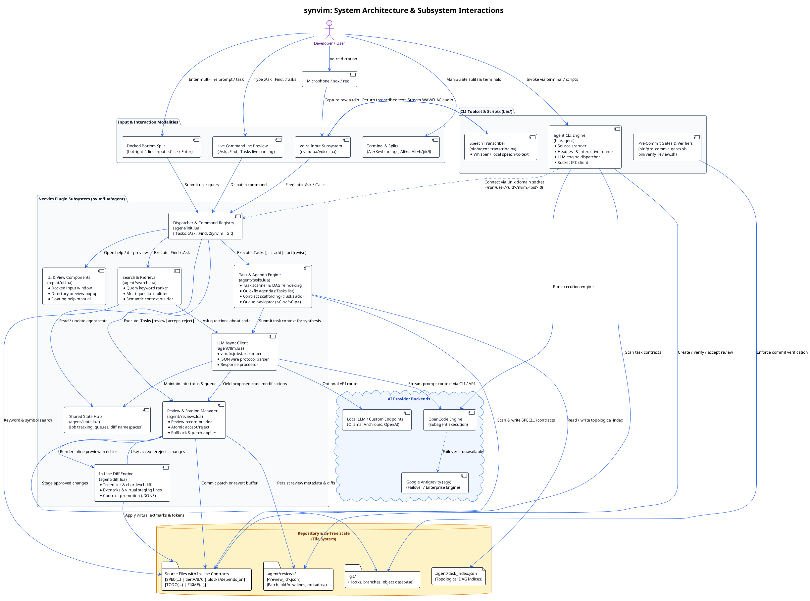
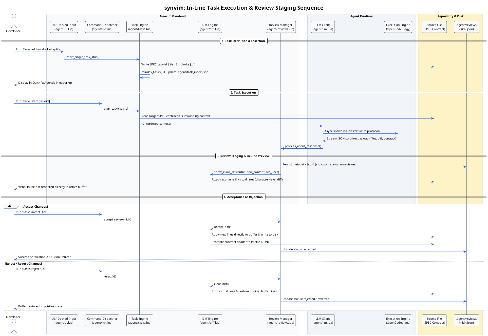

# synvim Architecture

This document describes the architectural layout, core subsystems, data flow, and interaction patterns of **synvim**—a Neovim configuration, terminal workspace, and source-anchored AI agent execution environment.

---

## 1. System Component Architecture

The following PlantUML diagram models the end-to-end component architecture, linking the user interaction modalities, Neovim agent runtime, CLI engines, filesystem persistence, and external LLM backends.

Source file: [`docs/architecture/synvim_architecture.puml`](file:///home/yassine/code/synvim/docs/architecture/synvim_architecture.puml) | Rendered: [SVG](file:///home/yassine/code/synvim/docs/architecture/synvim_architecture.svg) / [PNG](file:///home/yassine/code/synvim/docs/architecture/synvim_architecture.png)




---

## 2. In-Line Task Execution & Review Staging Lifecycle

Source file: [`docs/architecture/task_lifecycle.puml`](file:///home/yassine/code/synvim/docs/architecture/task_lifecycle.puml) | Rendered: [SVG](file:///home/yassine/code/synvim/docs/architecture/task_lifecycle.svg) / [PNG](file:///home/yassine/code/synvim/docs/architecture/task_lifecycle.png)




---

## 3. Core Architectural Subsystems

### 3.1. Neovim Agent Subsystem (`nvim/lua/agent/`)

- [`agent/init.lua`](file:///home/yassine/code/synvim/nvim/lua/agent/init.lua): Central initialization point. Maps user commands (`:Tasks`, `:Ask`, `:Find`, `:Synvim`, `:Git`) and wires callbacks into submodules.
- [`agent/tasks.lua`](file:///home/yassine/code/synvim/nvim/lua/agent/tasks.lua): Scans project files for in-tree `SPEC(...)` and `TODO(...)` comment contracts. Builds and maintains a topological dependency DAG in `.agent/task_index.json`. Manages the Quickfix agenda window and task decomposition.
- [`agent/diff.lua`](file:///home/yassine/code/synvim/nvim/lua/agent/diff.lua): High-fidelity inline diff renderer. Computes token- and character-level diffs (`compute_char_diff`), applies extmarks and virtual lines above target regions, and handles contract promotion to `(status:DONE)` upon acceptance.
- [`agent/reviews.lua`](file:///home/yassine/code/synvim/nvim/lua/agent/reviews.lua): Manages review records stored in `.agent/reviews/<id>.json`. Guarantees atomic staging and instant reverts (`revert_review`) without leaving dangling edits.
- [`agent/search.lua`](file:///home/yassine/code/synvim/nvim/lua/agent/search.lua): Query parsing, semantic symbol extraction, keyword ranking, and multi-question query splitting (`split_questions`) with question queue navigation (`<C-n>` / `<C-p>`).
- [`agent/llm.lua`](file:///home/yassine/code/synvim/nvim/lua/agent/llm.lua): Non-blocking asynchronous task execution using `vim.fn.jobstart`. Parses raw stdout/stderr wire protocols, extracts structured JSON solutions, and dispatches to OpenCode or Antigravity (`agy`).
- [`agent/cmdline.lua`](file:///home/yassine/code/synvim/nvim/lua/agent/cmdline.lua) & [`agent/ui.lua`](file:///home/yassine/code/synvim/nvim/lua/agent/ui.lua): UI layout managers handling docked bottom input splits (`open_docked_input`), directory tree previews, floating help, and statusline notifications.
- [`agent/state.lua`](file:///home/yassine/code/synvim/nvim/lua/agent/state.lua): Global singleton tracking active jobs, queue indices, pending diff extmarks, and terminal context.

### 3.2. Voice Input Subsystem (`nvim/lua/voice.lua`)

Provides hands-free voice-to-text queries. Captures audio via system recording tools (`rec` / `sox`) and invokes [`bin/agent_transcribe.py`](file:///home/yassine/code/synvim/bin/agent_transcribe.py) powered by Whisper. The transcribed prompt is automatically injected into `:Ask` or `:Tasks add`.

### 3.3. Standalone CLI Engine (`bin/agent`)

A source-first execution engine implemented in Python that mirrors Neovim's agent capabilities in headless terminal environments or CI pipelines:
- Inspects codebases for `SPEC(...)` and `TODO(...)` comments.
- Dispatches prompts to OpenCode or Antigravity (`agy`) with automatic failover.
- Connects to running Neovim sessions via Unix domain sockets located at `/run/user/<uid>/nvim.<pid>.0` to drive interactive in-editor diff reviews.

### 3.4. In-Tree Contract Format & Verification

Tasks are anchored directly into source files using language-appropriate comment syntax:

```text
# SPEC(<id> | tier:<A|B|C> | blocks:[<id>] | depends_on:[<id>]):
#   action:    <Task instruction>
#   requires:  [<prerequisites>]
#   ensures:   review: "<Verification criteria>"
#   invariant: "<Safety or architectural constraints>"
#   modifies:  [<affected files>]
```

This ensures that tasks remain persistent, version-controlled with the codebase, and immune to session crashes.

---

## 4. Diagram Generation Script

To render or update the SVG and PNG images from the `.puml` files at any time, run:

```bash
./docs/architecture/generate_diagrams.sh
```

### Options:
- **`--format <svg|png|all>`**: Select the output image format (defaults to `all`).
- **`--engine <auto|local|docker|kroki>`**: Choose the rendering engine (defaults to `auto`, which checks local `plantuml`, `docker`, and seamlessly falls back to Kroki API with zero dependencies required).
- **`-o, --output-dir <path>`**: Set custom output directory.

